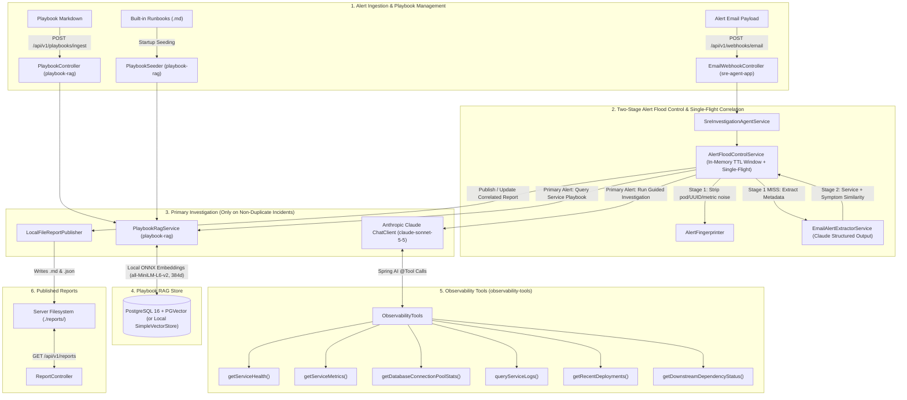
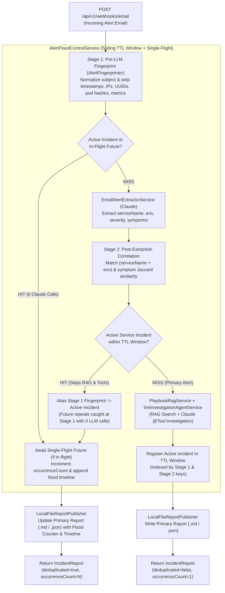
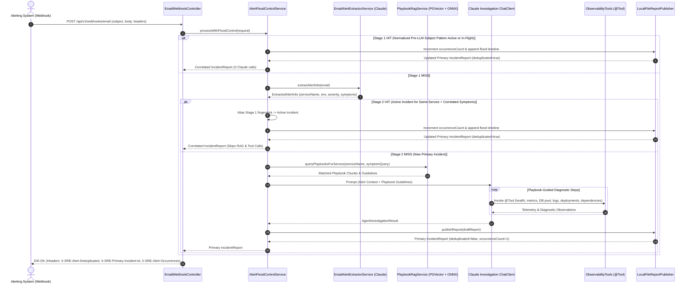

# SRE Agent Demo (Spring Boot 4.1.2 + Spring AI 2.0.2 + Anthropic Claude + PGVector RAG)

> [!IMPORTANT]
> **Disclaimer — Demonstration & Personal Exploration Only**
> This repository is a **demonstration project** intended strictly for personal learning and exploration of agentic AI concepts (structured extraction, Playbook RAG, tool calling, and alert flood deduplication). It uses simulated observability tools and simplified in-memory/local patterns and is **not** a production-ready codebase.

A multi-module Maven project implementing an autonomous Site Reliability Engineering (SRE) Agent powered by **Spring Boot 4.1.2**, **Spring AI 2.0.2**, **Java 25**, **Anthropic Claude** (`ANTHROPIC_API_KEY`), and **Local ONNX Transformers Embeddings** (`all-MiniLM-L6-v2`).

The agent receives alert emails via webhook, suppresses/correlates alert floods using a **Two-Stage Deduplication & Single-Flight Coalescing Pipeline**, extracts structured service and symptom metadata using Claude, queries service runbooks/playbooks via **RAG** (PostgreSQL + `pgvector` or local in-memory vector store with in-process ONNX embeddings), executes playbook-prescribed diagnostic steps using Spring AI `@Tool` functions, and publishes both **Markdown (`.md`)** and **JSON (`.json`)** incident reports.

---

## Solution Architecture & Workflow

### 1. Component Architecture


### 2. Two-Stage Alert Flood Control & Single-Flight Pipeline


### 3. End-to-End Investigation & Flood Suppression Sequence


---

## Alert Flood Control & Deduplication Strategy

During a production incident ("alert storm"), monitoring systems often emit dozens of similar alerts within seconds. `AlertFloodControlService` and `AlertFingerprinter` handle these floods across three layers:

1. **Stage 1: Pre-LLM Fingerprint Normalization (`0` Claude API Calls)**:
   - Strips dynamic telemetry noise from raw email subjects before calling Claude: Kubernetes pod suffixes (`-7d9f8b6c4-x2k9p`), UUIDs, IPv4 addresses, ISO timestamps, build/ticket numbers (`#8841`), and fluctuating metric readings (`34.8%`, `5,020ms`).
   - If the normalized fingerprint matches an active incident within the suppression window (`sre.agent.deduplication.window`, default `15m`), the alert is immediately correlated into the primary `IncidentReport` with **zero LLM calls**.
2. **Stage 2: Post-Extraction Service & Symptom Correlation (Skips RAG & Tool Investigation)**:
   - When a *differently worded* alert email arrives for the same outage (e.g., `payment-service HTTP 5xx spike` followed by `payment-service HikariPool-1 connection timeout`), Stage 1 lets it through to lightweight Claude metadata extraction.
   - Stage 2 matches the extracted `(serviceName, environment)` scope and checks token Jaccard similarity across `alertTitle`, `errorSummary`, `symptoms`, and `affectedEndpointsOrResources` (plus automatic correlation for concurrent `P1`/`CRITICAL` alerts on the same service).
   - On a Stage 2 match, it **skips RAG and multi-tool investigation**, correlates the alert into the active incident report, and **aliases the new Stage 1 fingerprint** to the active incident so subsequent repeats of that second alert template are caught at Stage 1 with `0` LLM calls.
3. **Single-Flight Concurrency Coalescing (`CompletableFuture`)**:
   - If a burst of concurrent webhook requests arrives simultaneously while the primary investigation (~5–10s) is still running, follower requests wait on the leader's in-flight `CompletableFuture` rather than triggering parallel investigations.

---

## Project Structure

- **`sre-common`**: Shared domain records (`EmailWebhookRequest`, `ExtractedAlertInfo`, `PlaybookIngestRequest`, `PlaybookChunkResult`, `AgentInvestigationResult`, `IncidentReport` with `CorrelatedAlert` flood timeline metadata).
- **`playbook-rag`**: Playbook RAG ingestion and semantic retrieval backed by **PostgreSQL + PGVector** (`spring-ai-starter-vector-store-pgvector`) and **Local ONNX Transformers Embeddings** (`spring-ai-starter-model-transformers`, bundled `all-MiniLM-L6-v2` with `384` dimensions), plus a `local` profile fallback (`SimpleVectorStore`) and built-in playbooks (`payment-service`, `order-service`, `auth-service`).
- **`observability-tools`**: Spring AI `@Tool` functions (`ObservabilityTools`) providing simulated observability & infrastructure checks (`getServiceHealth`, `getServiceMetrics`, `getDatabaseConnectionPoolStats`, `queryServiceLogs`, `getRecentDeployments`, `getDownstreamDependencyStatus`).
- **`sre-agent-app`**: Spring Boot application exposing the email webhook, two-stage alert flood control (`AlertFloodControlService`, `AlertFingerprinter`, `AlertDeduplicationProperties`), playbook ingestion/search endpoints, Anthropic Claude investigation agent orchestrator (`spring-ai-starter-model-anthropic`), and local filesystem report publisher (`./reports/`).

---

## REST API & Webhook Reference

| Method | Endpoint | Description |
|---|---|---|
| `POST` | `/api/v1/webhooks/email` | Receive an alert email, run Two-Stage Flood Control, and execute or correlate an SRE investigation. Returns `IncidentReport` and headers `X-SRE-Alert-Deduplicated`, `X-SRE-Primary-Incident-Id`, and `X-SRE-Alert-Occurrences`. |
| `GET` | `/api/v1/webhooks/deduplication/stats` | Inspect active incident suppression windows, `totalAlertsReceived`, `primaryInvestigationsTriggered`, `stage1SuppressedCount`, and `stage2SuppressedCount`. |
| `DELETE` | `/api/v1/webhooks/deduplication/cache` | Clear all active deduplication windows and reset flood counters (useful when re-running demos). |
| `POST` | `/api/v1/playbooks/ingest` | Ingest or update a Markdown service playbook into the Vector Store. |
| `GET` | `/api/v1/playbooks/search` | Query playbook chunks via semantic search (`?serviceName=...&query=...&topK=4`). |
| `GET` | `/api/v1/reports` | List generated `.md` and `.json` incident reports in `./reports/`. |
| `GET` | `/api/v1/reports/{filename}` | View a specific Markdown or JSON incident report. |

---

## Configuration Properties (`application.yml` / Environment Variables)

| Property | Env Variable | Default | Description |
|---|---|---|---|
| `spring.ai.anthropic.api-key` | `ANTHROPIC_API_KEY` | — | Anthropic API key for Claude chat, extraction, and tool investigation |
| `spring.ai.anthropic.chat.model` | `ANTHROPIC_MODEL` | `claude-sonnet-5-5` | Anthropic Claude model for extraction & tool investigation |
| `spring.ai.vectorstore.pgvector.dimensions` | — | `384` | Vector dimension matching the bundled `all-MiniLM-L6-v2` ONNX embedding model |
| `sre.playbook.seed-on-startup` | `SRE_SEED_PLAYBOOKS` | `true` | Seed built-in playbooks (`payment-service`, `order-service`, `auth-service`) on startup |
| `sre.agent.reports-dir` | `SRE_REPORTS_DIR` | `./reports` | Local directory where `.md` and `.json` incident reports are saved |
| `sre.agent.deduplication.enabled` | `SRE_DEDUP_ENABLED` | `true` | Enable/disable two-stage alert flood deduplication |
| `sre.agent.deduplication.window` | `SRE_DEDUP_WINDOW` | `15m` | Active incident suppression TTL window |
| `sre.agent.deduplication.symptom-similarity-threshold` | `SRE_DEDUP_SIMILARITY_THRESHOLD` | `0.20` | Stage 2 Jaccard token similarity threshold across symptoms/resources |
| `sre.agent.deduplication.correlate-same-service-critical` | `SRE_DEDUP_SAME_SERVICE_CRITICAL` | `true` | Automatically correlate concurrent `P1`/`CRITICAL` alerts on the same service & environment |

---

## Prerequisites

- **Java 25** (or open inside the included **Java 25 Dev Container** in `.devcontainer/`)
- **Maven 3.9+**
- **Docker** (for Dev Container and/or PostgreSQL + `pgvector`)
- **Anthropic API Key** (`ANTHROPIC_API_KEY`)

## Running in the Java 25 Dev Container (VS Code / Antigravity IDE)

1. Open the command palette (`Ctrl+Shift+P`) and run **`Dev Containers: Reopen in Container`**.
   - This builds [.devcontainer/Dockerfile](file:///workspaces/sre-agent-demo/.devcontainer/Dockerfile) (`mcr.microsoft.com/devcontainers/java:25` with Maven) and starts `postgres-pgvector` automatically via [.devcontainer/docker-compose.yml](file:///workspaces/sre-agent-demo/.devcontainer/docker-compose.yml).
2. Add your `ANTHROPIC_API_KEY` to [.env](file:///workspaces/sre-agent-demo/.env) (see [.env.example](file:///workspaces/sre-agent-demo/.env.example)).
3. Launch any configuration from the **Run and Debug** panel (`Ctrl+Shift+D`), configured in [.vscode/launch.json](file:///workspaces/sre-agent-demo/.vscode/launch.json):
   - **`SRE Agent App (PGVector - Port 8080)`**
   - **`SRE Agent App (Local VectorStore / No Docker - Port 8080)`**
   - **`Playbook RAG Service (PGVector - Port 8081)`**
   - **`Playbook RAG Service (Local VectorStore / No Docker - Port 8081)`**

## CLI Quick Start & Testing Alert Flood Suppression

### 1. Start PostgreSQL with PGVector
```bash
docker compose up -d
```

### 2. Set Your Anthropic API Key, Build Modules, and Run the Application
```bash
set -a && source .env && set +a
mvn install -DskipTests
mvn spring-boot:run -pl sre-agent-app
```

### 3. Send Primary Alert Email (Triggers Full RAG + Tool Investigation)
```bash
curl -i -X POST http://localhost:8080/api/v1/webhooks/email \
  -H "Content-Type: application/json" \
  -d '{
    "messageId": "alert-20261116-001",
    "from": "pagerduty-alerts@example.com",
    "subject": "[CRITICAL / P1] payment-service HTTP 5xx Error Spike & Checkout Latency on pod payment-service-7d9f8b6c4-x2k9p (34.8%)",
    "body": "Alert triggered for payment-service in prod-us-east-1 on POST /api/v1/payments/charge. HTTP 5xx rate exceeded 34%, p99 latency > 5s, and HikariPool-1 connection timeouts observed."
  }'
```
- Returns `X-SRE-Alert-Deduplicated: false` and `X-SRE-Alert-Occurrences: 1`.

### 4. Simulate a Stage 1 Flood Repeat (Different Pod & Metric Reading -> 0 Claude Calls)
```bash
curl -i -X POST http://localhost:8080/api/v1/webhooks/email \
  -H "Content-Type: application/json" \
  -d '{
    "messageId": "alert-20261116-002",
    "from": "pagerduty-alerts@example.com",
    "subject": "[CRITICAL / P1] payment-service HTTP 5xx Error Spike & Checkout Latency on pod payment-service-7d9f8b6c4-z9m4q (41.2%)",
    "body": "Alert triggered for payment-service in prod-us-east-1 on POST /api/v1/payments/charge. HTTP 5xx rate exceeded 41%."
  }'
```
- Returns `X-SRE-Alert-Deduplicated: true` and `X-SRE-Alert-Occurrences: 2` instantaneously without calling Claude.

### 5. Simulate a Stage 2 Related Service Alert (Different Subject Line -> Skips RAG & Tool Calls)
```bash
curl -i -X POST http://localhost:8080/api/v1/webhooks/email \
  -H "Content-Type: application/json" \
  -d '{
    "messageId": "alert-20261116-003",
    "from": "datadog-monitors@example.com",
    "subject": "[P1] HikariPool-1 Database Connection Pool Saturated on payment-service",
    "body": "Monitor: HikariPool-1 Active Connections 20/20 in prod-us-east-1. 148 threads awaiting DB connection on payment-service (/api/v1/payments/charge)."
  }'
```
- Returns `X-SRE-Alert-Deduplicated: true` and `X-SRE-Alert-Occurrences: 3`, aliases the new subject into Stage 1, and appends the event to the primary incident report's **Alert Flood & Deduplication Timeline** table.

### 6. Inspect Deduplication Stats & Generated Reports
```bash
curl http://localhost:8080/api/v1/webhooks/deduplication/stats
curl http://localhost:8080/api/v1/reports
```

## Prompt-injection defenses (defence in depth, not a complete control)

Layers: `@SafeText`/`@Size` request validation, `UntrustedContent` fencing of untrusted text, `PromptGuardrailAdvisor`
(scans only the raw email fence), playbook validation at ingest, and server-side tool scoping via `ToolContext`
(tools fail closed and return an error if the requested service differs from the alerted one).
The regex detector is heuristic: it can be evaded by paraphrase, other languages or homoglyphs, and may flag unusual
but benign text. Fencing, role-tag/fence-spoof rules and tool scoping are the most reliable layers.
Blocked requests return `400` (`PROMPT_INJECTION_BLOCKED` or `VALIDATION_FAILED`) without echoing the payload.
